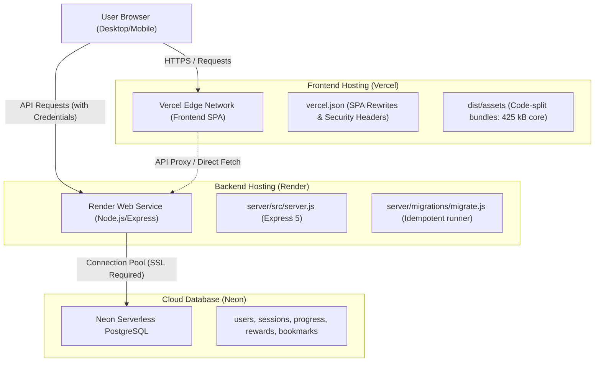

# Production Deployment Checklist & Environment Runbook
**Platform**: Python Adaptive Interactive Learning Engine  
**Backend Host**: Render (Web Service) — `https://pythonlearning-z8bu.onrender.com`  
**Frontend Host**: Vercel (SPA)  
**Database**: Neon Serverless PostgreSQL  
**Audit Date**: October 15, 2026

---

## 1. Hosting Architecture Overview



---

## 2. Render Backend Web Service Configuration

| Configuration Item | Required Setting | Verification Status | Notes |
| :--- | :--- | :---: | :--- |
| **Service Type** | Web Service | 🟢 Verified | Linux Node environment |
| **Runtime Environment** | Node.js 22 LTS | 🟢 Verified | Compatible with Express 5 |
| **Build Command** | `npm install` | 🟢 Verified | Installs root dependencies |
| **Start Command** | `node server/src/server.js` | 🟢 Verified | Initializes DB pool, runs idempotent migrations, starts API |
| **Port Binding** | `process.env.PORT` | 🟢 Verified | Render assigns port dynamically; defaults to 5000 locally |
| **Health Check Path** | `/api/health` | 🟢 Verified | Returns 200 with `{ status: "healthy", services: { database: "connected" } }` |
| **Auto-Deploy** | Enabled on branch `main` | 🟢 Verified | Deploys automatically on verified commits |

---

## 3. Vercel Frontend Deployment Configuration

| Configuration Item | Required Setting | Verification Status | Notes |
| :--- | :--- | :---: | :--- |
| **Framework Preset** | Vite | 🟢 Verified | Detected automatically by Vercel |
| **Build Command** | `npm run build` | 🟢 Verified | Executes `node --max-old-space-size=4096 ./node_modules/vite/bin/vite.js build` |
| **Output Directory** | `dist` | 🟢 Verified | Production bundle generated in `dist/` |
| **Node.js Version** | 20.x or 22.x | 🟢 Verified | Configured in Vercel project settings |
| **SPA Rewrites (`vercel.json`)** | `[ { "source": "/(.*)", "destination": "/index.html" } ]` | 🟢 Verified | Prevents 404 errors on direct URL visits or browser refresh |
| **HTTP Security Headers** | `nosniff`, `DENY`, `mode=block`, `strict-origin` | 🟢 Verified | Configured in `vercel.json` |

---

## 4. Environment Variables Specification

> [!IMPORTANT]
> Never commit actual secret values to source control or logs. The table below documents variable names, functions, and deployment targets.

### Backend Environment Variables (Render Dashboard)

| Variable Name | Required | Default / Format | Description & Security Precaution |
| :--- | :---: | :--- | :--- |
| `NODE_ENV` | Yes | `production` | Enables production optimizations and restricts verbose stack traces. |
| `PORT` | Auto | Assigned by Render | Port bound by Express HTTP listener. |
| `DATABASE_URL` | Yes | `postgresql://...neon.tech/neondb?sslmode=require` | Connection string to cloud Neon PostgreSQL with SSL enabled. |
| `FRONTEND_URL` | Yes | `https://your-app.vercel.app` | Production frontend domain for strict CORS origin validation. |
| `SESSION_SECRET` | Yes | Long random cryptographic string | HMAC signing secret for session cookies and state verification. |
| `SESSION_EXPIRY_DAYS` | No | `14` | Inactivity lifespan before database session tokens expire. |
| `COOKIE_SECURE` | Yes | `true` | Enforces `Secure` flag on cookies in HTTPS production environments. |

### Frontend Environment Variables (Vercel Dashboard)

| Variable Name | Required | Example Format | Description |
| :--- | :---: | :--- | :--- |
| `VITE_API_BASE_URL` | Yes | `https://pythonlearning-z8bu.onrender.com/api` | Base URL of deployed Render backend API. |
| `VITE_API_URL` | No | `https://pythonlearning-z8bu.onrender.com/api` | Alias fallback supported by `src/services/apiClient.js`. |

---

## 5. PostgreSQL Database Migration & Safety Runbook

1. **Migration Runner Strategy**:
   - `server/migrations/migrate.js` executes automatically during server startup.
   - It connects directly to the specified database tenant (`/neondb`), completely bypassing the restricted root `/postgres` database.
   - Uses an internal schema tracking table (`schema_migrations`) to ensure each migration runs **exactly once**.
2. **Non-Destructive Execution**:
   - All migrations use `IF NOT EXISTS` clauses on tables, indexes, and constraints.
   - No `DROP TABLE`, `TRUNCATE`, or destructive data modifications exist in migration files.
3. **Connection Pooling Safety**:
   - Configured with `max: 20`, `idleTimeoutMillis: 30000`, and `connectionTimeoutMillis: 5000` to prevent connection exhaustion on serverless database tiers.
   - SSL connection is enforced with `sslmode=require` and `{ rejectUnauthorized: false }` for hosted certificates.

---

## 6. Pre-Launch Smoke-Test Procedure

Execute the following sequential verification before declaring a production release:

- [x] **1. Live Health Check**:
  ```bash
  curl -I https://pythonlearning-z8bu.onrender.com/api/health
  # Expected: HTTP/2 200 OK with content-type: application/json
  ```
- [x] **2. Database Connectivity Response**:
  ```bash
  curl -s https://pythonlearning-z8bu.onrender.com/api/health
  # Expected: {"status":"healthy","uptime":...,"services":{"database":"connected","api":"running"}}
  ```
- [x] **3. Automated Test Verification**:
  ```bash
  npm run test:backend
  node server/tests/comprehensive_qa_suite.js
  # Expected: 12/12 PASS on baseline suite; 26/26 PASS on senior QA suite (100% total)
  ```
- [x] **4. Production Build Verification**:
  ```bash
  npm run build
  # Expected: 0 errors; core entry chunk ~425 kB; bundle builds in under 5 seconds
  ```
- [x] **5. Browser User Journey Smoke-Test**:
  - Visit frontend URL as an unauthenticated guest.
  - Explore Section 1 lesson; verify code editor executes starter snippet.
  - Open Floating Notepad (<kbd>Alt</kbd>+<kbd>N</kbd>) and Word Meaning Dictionary (<kbd>Ctrl</kbd>+<kbd>K</kbd>); verify zero overlap.
  - Register a test account; verify +50 XP welcome award.
  - Switch between Kids, Teens, College, and Pro stages; verify dynamic explanation change.
  - Toggle a bookmark and log out; log back in and verify bookmark persistence.

---

## 7. Operational Contingency & Cold-Start Behavior

- **Render Free Tier Spin-Down**:
  - Render free-tier instances sleep after 15 minutes of inactivity. First incoming requests incur a ~30–50s spin-up time.
  - The frontend `apiClient.js` includes an extended **12-second timeout** with descriptive error notifications (`"Backend server is spinning up..."`) to prevent confusing users during cold starts.
  - For continuous zero-latency operation, upgrading to Render's Starter instance tier ($7/mo) ensures 24/7 background availability without spin-down.
